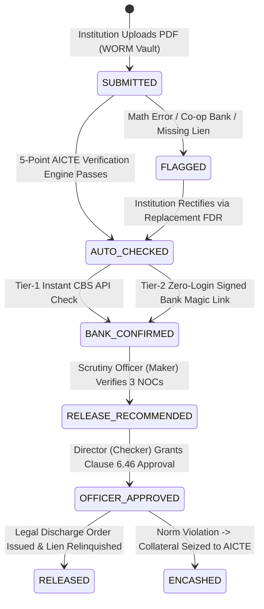
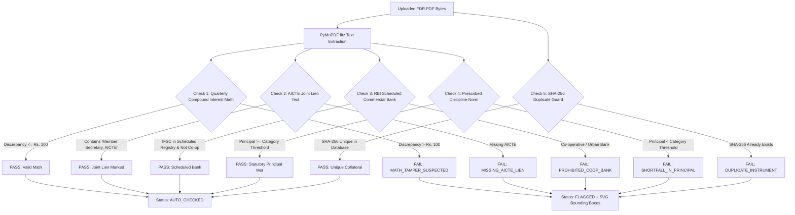
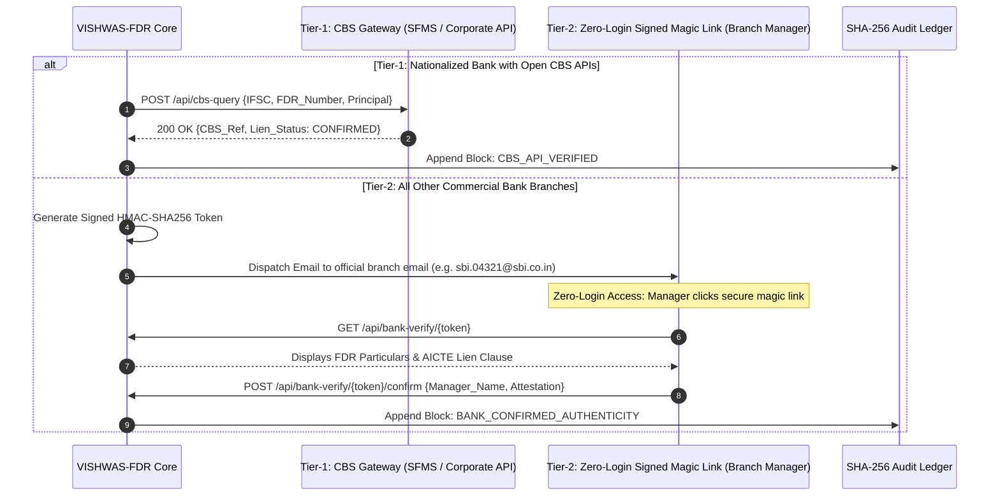
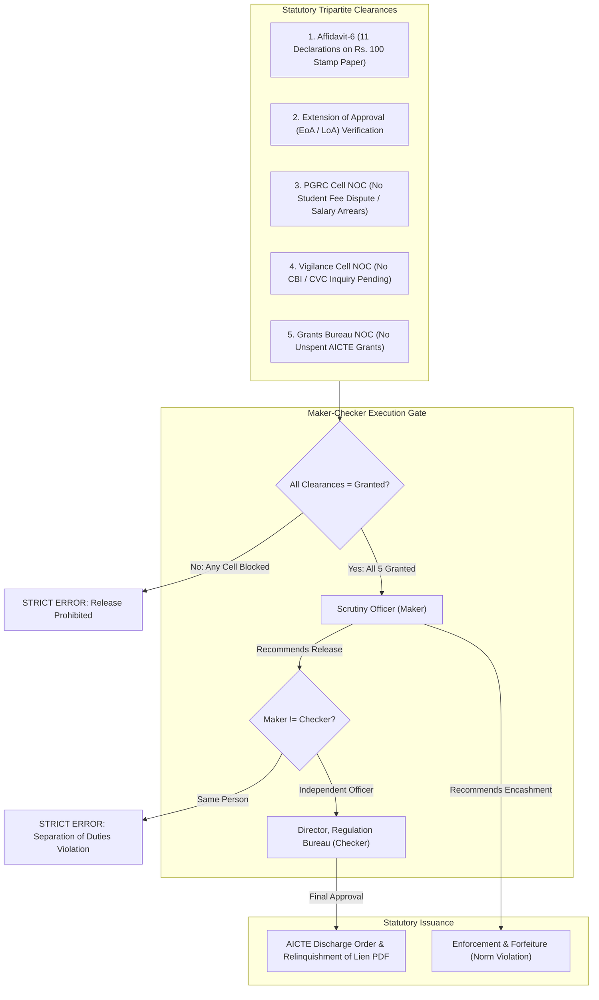
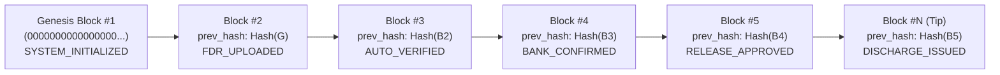
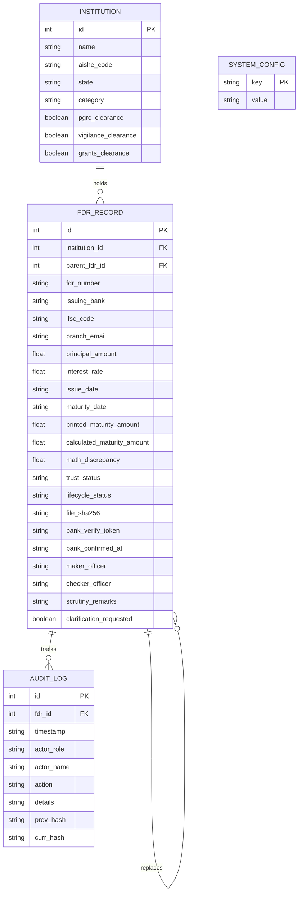

# VISHWAS-FDR | Complete Master Architecture & Technical Blueprint
## Government of India • Ministry of Education • AICTE Regulation Bureau
**Smart India Hackathon 2026** | **Problem Statement ID**: 26265  
**Theme**: Smart Automation | **Team**: OG-7  
**Core Philosophy**: *"Trust Ladder + Never Miss a Deadline"*

---

## 1. Executive Summary & Problem Context

Under the **AICTE Approval Process Handbook (APH 2024–2027)**, technical and higher education institutions in India pledge over **₹2,500 Crores in Fixed Deposit Receipts (FDRs)** with the Member Secretary, AICTE as statutory security deposits to establish new campuses or introduce new academic programs.

```
+---------------------------------------------------------------------------------------+
|                                 STATUTORY DEPOSIT NORMS                               |
|  * Engineering & Technology (New Campus)    : Rs. 35,00,000  (APH Clause 6.4 / App. 6)|
|  * Pharmacy / Architecture / Planning       : Rs. 15,00,000                           |
|  * Management (MBA) / Computer Apps (MCA)   : Rs. 15,00,000                           |
|  * Mandatory Tenure                         : 5 to 10 Years (Term Deposit)            |
|  * Statutory Account Holding                : Jointly with Member Secretary, AICTE    |
+---------------------------------------------------------------------------------------+
```

### The Regulatory Vulnerabilities Solved by VISHWAS-FDR
1. **Mathematical Tampering & Doctored Values**: Rogue institutions inflate printed maturity figures by up to 25% to fake statutory compliance while depositing far lower sums in reality.
2. **Prohibited Co-operative Banks**: Colleges bypass RBI Scheduled Commercial Bank guidelines by investing in local co-operative or urban credit societies that carry high insolvency risks.
3. **Missing Tripartite Lien**: FDR certificates issued solely in the Trust’s name without marking an irrevocable lien to AICTE, allowing institutions to encash deposits prematurely.
4. **Untracked Maturity & Silent Defaults**: Security deposits maturing unnoticed after 5 years, resulting in councils holding lapsed paper instruments while colleges liquidate public collateral.
5. **High-Risk Release Disputes**: Institutions demanding ₹35L / ₹15L refunds under Clause 6.46 while having pending student fee refund complaints before the Public Grievance Redressal Cell (PGRC) or active Vigilance/CBI inquiries.
6. **CAG & RTI Scrutiny Bottlenecks**: Absence of an unalterable forensic audit trail documenting who verified, recommended, and approved each financial release over a 10-year period.

---

## 2. High-Level System Architecture

VISHWAS-FDR is engineered as a decoupled, production-grade enterprise system conforming to **MeitY UX4G 3.0** and **GIGW (Guidelines for Indian Government Websites)** standards.

```mermaid
flowchart TD
    subgraph Client_Layer["Presentation Tier (Next.js 14 App Router - UX4G 3.0 / GIGW)"]
        UI_Dash["/dashboard (Executive Overview & Heatmap)"]
        UI_Sub["/submissions/new (3-Step WORM Submission Wizard)"]
        UI_MyDep["/my-deposits (Institution Portfolio & Rectification)"]
        UI_Scrut["/scrutiny & /scrutiny/[id] (Officer Workstation)"]
        UI_Life["/lifecycle (Maturity T-90/60/30/7 & Clause 6.46)"]
        UI_Audit["/audit (SHA-256 Ledger & Chain Verifier)"]
        UI_Bank["/bank-verify/[token] (Zero-Login CBS Bank Portal)"]
        UI_Set["/settings (Regulatory APH Policies)"]
    end

    subgraph API_Layer["Application Tier (FastAPI Enterprise Engine)"]
        V_Engine["5-Point APH Verification Engine"]
        M_Engine["Quarterly Compounding Math ($A = P(1+r/400)^{4n}$)"]
        OCR_Engine["PyMuPDF Dynamic Text & SVG Overlay Extractor"]
        Bank_Bridge["Two-Tier Bank CBS Verification Bridge"]
        Time_Machine["Temporal Clock Simulator & Escalation Engine"]
        Gatekeeper["Clause 6.46 Maker-Checker Gatekeeper"]
        PDF_Gen["ReportLab Statutory Legal Document Generator"]
        Audit_Core["WORM SHA-256 Hash Chain Manager"]
    end

    subgraph Data_Layer["Persistence & Cryptographic Storage Tier"]
        DB[(SQLite Persistent Relational Store)]
        WORM_Store[WORM Storage: Read-Only PDF Vault]
        PNG_Store[Rendered Canvas & Bounding Box Cache]
        Hash_Ledger[(SHA-256 Cryptographic Audit Ledger)]
    end

    Client_Layer <-->|REST API + Cryptographic Tokens| API_Layer
    API_Layer <--> Data_Layer
```



---

## 3. The 4-Stage Trust Ladder Architecture

Rather than treating verification as a binary yes/no flag, VISHWAS-FDR establishes an institutional **Trust Ladder** representing the verifiable lifecycle of every security deposit:



### Trust Status Definitions
1. **`SUBMITTED` [Claimed]**: The institution has submitted the FDR particulars and uploaded the digital certificate. WORM SHA-256 digest is generated.
2. **`AUTO_CHECKED` [OCR + Math]**: The 5-point verification engine has verified quarterly compounding math, AICTE joint lien text, scheduled bank status, and prescribed category principal.
3. **`FLAGGED` [Defective]**: Discrepancies detected (e.g., math tampering > ₹100, non-scheduled co-operative bank, missing AICTE joint-lien, duplicate instrument). Clarification is requested from the institution.
4. **`BANK_CONFIRMED` [Bank Attested]**: Independent issuing bank confirmation achieved via either simulated CBS API or zero-login Branch Manager digital attestation.
5. **`OFFICER_APPROVED` [Regulatory Clearance]**: Final approval granted under Clause 6.46 by the Bureau Director following tripartite cell NOC clearances.

---

## 4. The 5-Point AICTE APH Entry Verification Engine

When a document is uploaded, the engine executes 5 statutory checks without human intervention:



### Detailed Mathematical Formulation (Check 1)
In accordance with Reserve Bank of India Master Direction on Term Deposits, commercial banks calculate interest on deposits exceeding 90 days on a **quarterly compounding basis**:

$$\text{Maturity Value } A = P \times \left(1 + \frac{r}{400}\right)^{4 \times n}$$

Where:
- $P$ = Principal deposit amount in INR.
- $r$ = Annual interest rate percentage (e.g., $7.0\%$).
- $n$ = Exact tenure in fractional years, calculated from statutory dates:
  $$n = \frac{\text{Maturity Date} - \text{Issue Date}}{365.25}$$

**Tampering Detection Threshold**:
$$\Delta = |A_{\text{calculated}} - A_{\text{printed}}|$$
If $\Delta > \text{MATH\_TOLERANCE\_INR}$ (default: ₹100), the instrument is automatically flagged with `MATH_TAMPER_SUSPECTED`.

### Dynamic SVG Coordinate Bounding Box Overlay
PyMuPDF (`fitz`) searches for exact character rects $[x_0, y_0, x_1, y_1]$ within the PDF page coordinate space ($0 \le x \le \text{width}, 0 \le y \le \text{height}$). These coordinates are normalized to percentages:
$$x_{\text{pct}} = \frac{x_0}{\text{width}} \times 100, \quad y_{\text{pct}} = \frac{y_0}{\text{height}} \times 100$$
The frontend renders scalable SVG rects over the high-resolution PNG canvas, providing scrutiny officers with immediate visual evidence.

---

## 5. Two-Tier Bank Verification Bridge

To resolve the challenge of coordinating with over 150,000 commercial bank branches across India, VISHWAS-FDR implements a **Two-Tier Bank Verification Architecture**:



---

## 6. Time Machine Simulation & Proactive Reminder Ladder

To demonstrate statutory lifecycle automation during inspections and demonstrations without waiting 5 to 10 years, VISHWAS-FDR features an **Integrated Temporal Clock Simulator**:

### Configurable Reminder Ladder
The system monitors all active instruments against their maturity horizons:
- **$T-90$ Days**: Advance Reminder dispatched via Email/SMS to Institution Principal & Registrar.
- **$T-60$ Days**: Attention Notice dispatched; Regional Office copied.
- **$T-30$ Days**: Urgent Reminder dispatched with renewal submission link.
- **$T-7$ Days**: Critical Impending Expiry Warning.
- **Overdue Transition ($D < 0$)**: The instrument automatically flips to **`OVERDUE`**, receives an Urgency Score boost to position #1 on the Scrutiny Queue, and appends an `OVERDUE_ESCALATED_TO_DIRECTOR` block into the audit chain.

---

## 7. AICTE APH Clause 6.46 Maker-Checker Gatekeeper

Under Clause 6.46 of the Approval Process Handbook, refund or relinquishment of lien on fixed deposits is subject to strict statutory prerequisites:



### Official Legal Discharge Order PDF Generation
Upon Checker approval, the ReportLab engine dynamically produces a formal, sealed **AICTE Discharge Order & Relinquishment of Lien** document on official Council letterhead, complete with:
- Formal Council Reference Number (e.g., `AICTE/RB/FDR-REL/2026/0001`).
- Legal Citation of Clause 6.46 and relevant statutory provisions.
- Certified Institutional particulars (AISHE Code, Campus Name, State).
- Issuing Bank Details, Account Lien Release Order, and Bank Manager Directions.
- Digital Signatures of Scrutiny Officer (Maker) and Bureau Director (Checker).
- Official AICTE Emblem, Security Watermark, and SHA-256 verification digest.

---

## 8. Cryptographic SHA-256 WORM Forensic Audit Ledger

To satisfy statutory audits by the **Comptroller and Auditor General of India (CAG)** and judicial inquiries under the **Right to Information (RTI) Act**, VISHWAS-FDR implements an unalterable Write-Once, Read-Many (WORM) hash-chained ledger:



### Cryptographic Hash Function
Each audit block hash is computed strictly as:
$$H_i = \text{SHA-256}\left(H_{i-1} \,\|\, \text{Timestamp} \,\|\, \text{ActorRole} \,\|\, \text{Action} \,\|\, \text{FDR\_ID} \,\|\, \text{Details}\right)$$

### 1-Click Forensic Integrity Verifier (`GET /api/audit/verify`)
The system recomputes the SHA-256 digest of every block from Genesis to the tip. If even a single byte or status in the database is modified, the downstream hash chain breaks, pinpointing the exact compromised block ID and alerting the executive.

---

## 9. MeitY UX4G 3.0 & GIGW Visual Design System

The frontend is constructed using official Government of India design tokens:

| Element | Specification | UX4G Compliance |
| :--- | :--- | :--- |
| **National Header** | Indian Tricolor Strip (`#FF9933`, `#FFFFFF`, `#138808`) | Mandatory GIGW 3.0 requirement |
| **Gov Utility Ribbon** | Deep Navy (`#0B1F3A`) with Ashoka Stambh Emblem | Ministry of Education Standard |
| **Brand Navigation** | AICTE Royal Navy (`#1B365D`) + Brand Saffron (`#D97706`) | Official aicte.gov.in palette |
| **Surfaces** | Pure White (`#FFFFFF`) with Crisp Slate Borders (`#E2E8F0`) | Clean, non-distracting light mode |
| **Typography** | `'Noto Sans'`, `'Inter'`, Monospace for Financials & Hashes | High-readability multilingual support |
| **Accessibility Controls** | Font Resizing (`A-`, `A`, `A+`), High Contrast Mode Toggle | Level AA WCAG 2.1 Compliance |
| **Role Switcher** | Seamless testing across Institution, Maker, Checker, Bank Mgr | Multi-stakeholder demonstration |

---

## 10. Database Schema (Relational Architecture)



---

## 11. Complete REST API Specifications

| Method | Endpoint | Description |
| :--- | :--- | :--- |
| `GET` | `/api/dashboard` | Aggregates KPIs, state risk heatmap, and prioritized scrutiny list |
| `GET` | `/api/fdrs` | Lists all security deposit records with institution relations |
| `GET` | `/api/fdrs/{id}` | Retrieves full instrument particulars, bounding boxes, and flags |
| `GET` | `/api/fdrs/export-csv` | Streams the complete 19-column repository as a downloadable CSV |
| `POST` | `/api/fdrs/upload` | Multipart upload with PyMuPDF dynamic parsing & WORM storage |
| `POST` | `/api/fdrs/test-sample/{filename}` | Quick test upload of genuine, tampered, or co-op sample FDRs |
| `GET` | `/api/banks/ifsc-lookup/{ifsc}` | Real-time validation against RBI Scheduled Commercial Bank registry |
| `POST` | `/api/fdrs/{id}/simulate-cbs` | Tier-1 Core Banking System API check simulator |
| `POST` | `/api/fdrs/{id}/request-bank-verification` | Generates HMAC-SHA256 zero-login signed bank verification magic link |
| `GET` | `/api/bank-verify/{token}` | Displays instrument details to issuing Bank Branch Manager |
| `POST` | `/api/bank-verify/{token}/confirm` | Branch Manager attests to FDR authenticity & AICTE lien in CBS |
| `POST` | `/api/bank-verify/{token}/reject` | Branch Manager formally disputes non-genuine instrument |
| `POST` | `/api/fdrs/{id}/flag-observation` | Scrutiny Officer records observation remark / clarification notice |
| `POST` | `/api/fdrs/{id}/rectify` | Institution uploads replacement FDR to resolve defect flags |
| `POST` | `/api/simulation/set-date` | Fast-forwards or resets temporal clock ($0$ to $+180$ days) |
| `POST` | `/api/institutions/{id}/toggle-clearance` | Toggles PGRC, Vigilance, or Grants Bureau statutory NOC status |
| `POST` | `/api/fdrs/{id}/maker-recommend` | Scrutiny Officer (Maker) recommends release or invokes encashment |
| `POST` | `/api/fdrs/{id}/checker-approve` | Bureau Director (Checker) issues final regulatory approval |
| `GET` | `/api/fdrs/{id}/export-discharge-pdf` | Generates official AICTE Relinquishment of Lien Discharge Order PDF |
| `GET` | `/api/audit` | Retrieves paginated immutable audit blocks |
| `GET` | `/api/audit/verify` | Recomputes entire SHA-256 hash chain and confirms tamper-evidence |
| `GET` | `/api/audit/export-pdf` | Generates official Forensic Compliance Certificate PDF |
| `GET` | `/api/settings` | Returns statutory deposit norms, math tolerance, and reminder ladder |
| `PUT` | `/api/settings` | Dynamically updates APH regulatory policies and reminder intervals |

---

## 12. Security & Regulatory Compliance Checkpoints

1. **Section 65B Indian Evidence Act Admissibility**: Every transaction generates a SHA-256 hash digest, timestamp, and actor identity, qualifying as legally admissible electronic evidence in Indian courts.
2. **CERT-In Secure Coding Guidelines**: Input sanitization on all multipart file uploads, WORM filesystem write protection (`chmod 0o444`), and parameterized SQL queries to prevent injection.
3. **Data Protection & Privacy**: Bank magic links are signed with 256-bit entropy and restricted to individual instruments, preventing unauthorized cross-branch viewing.
4. **Comptroller and Auditor General (CAG) Readiness**: Full audit trail of security deposit balances, interest rates, and disposal orders downloadable in both structured CSV and signed PDF formats.

